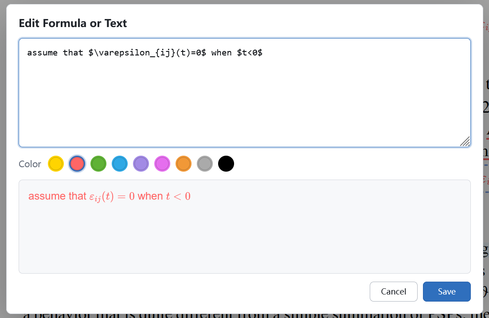
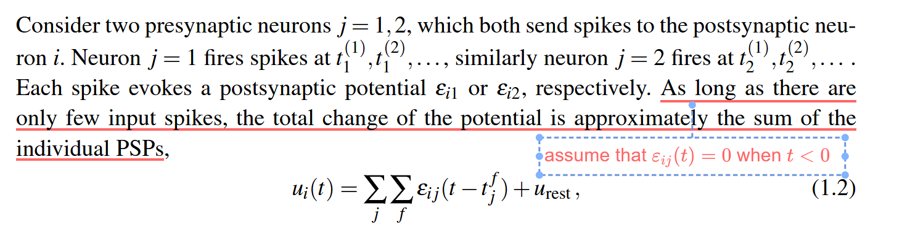

# Zotero LaTeX Math Tool

[](https://github.com/windingwind/zotero-plugin-template)

[中文说明](README_zh.md)

A lightweight formula plugin for Zotero that lets you annotate formulas
directly on PDF pages, so you can see your thoughts and understanding of the
text at a glance.

A Zotero plugin that adds a LaTeX math insertion tool to the PDF reader
toolbar. Free-text annotations may mix plain text with `$...$` inline math and
`$$...$$` display math; the plugin renders the whole annotation on the PDF
overlay with KaTeX. Annotations created by the plugin carry a `mathtool` tag;
native Zotero text annotations are never modified.

## Usage

1. Open a PDF attachment in Zotero.
2. Click the `Σ` toolbar button.


3. Click a position on the PDF page.
4. Type text directly. Wrap inline math in `$...$` and block equations in
   `$$...$$`. Use `\$` for a literal dollar sign. If the input has no `$` pair
   wrapping a formula, the whole input is inserted as a single block equation.
   For plain-text annotations, use Zotero's native text tool instead. You can
   later filter all equation annotations by the `mathtool` tag. Note that this
   plugin does not support full Markdown syntax and only renders formulas; for
   long-form Markdown notes, use Zotero's built-in note editor.



5. Pick one of Zotero's annotation colors (yellow, red, green, blue, purple,
   magenta, orange, gray, or black) before saving. The plugin remembers the
   last color you pick and reuses it for new equations.
6. Click `Insert` / `Save`.



7. Double-click a rendered annotation to edit it later.

Old `[[math:display]]` / `[[math:inline]]` annotations are still supported and
are migrated to the new syntax when edited. The source is stored as plain
annotation text (the `comment` field), so it syncs with Zotero normally; a
device without the plugin will show the raw source.

## Development

```bash
npm install
npm run build
```

The packaged `.xpi` is emitted by `zotero-plugin-scaffold` under `.scaffold/build`.

## Zotero Compatibility

The add-on manifest targets Zotero 9 and later:

```json
"strict_min_version": "9.0",
"strict_max_version": "10.*"
```

Zotero 7 and 8 may also work but are not tested. To try, change the
`strict_min_version` field in `addon/manifest.json` and re-package the `.xpi`.

## Acknowledgements

- [Zotero Community](https://www.zotero.org/)
- [Linux.do](https://linux.do/)
