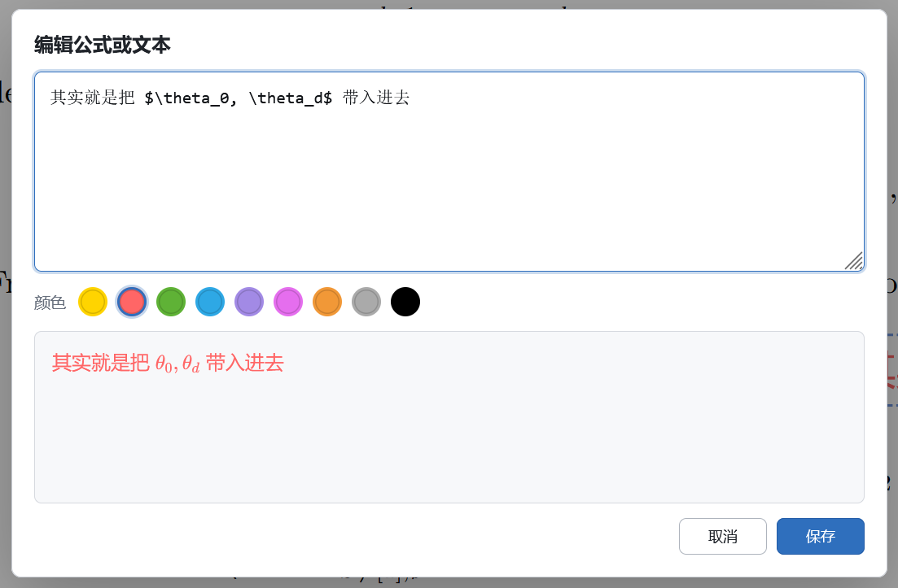
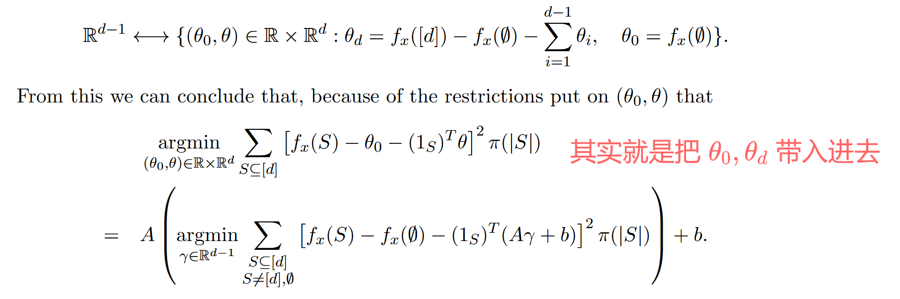

# Zotero LaTeX Math Tool

[](https://github.com/windingwind/zotero-plugin-template)

[English](README.md)

这是一个适用于 Zotero 的轻量公式插件，可以把公式直接标注在 PDF 页面上，方便直观地看到自己对原文的思考理解。

它会在 PDF 阅读器工具栏中添加公式按钮，并使用 KaTeX 把自由文本标注渲染到 PDF 注释层。标注里可以混写普通文本和 `$...$` 行内公式、`$$...$$` 块级公式。插件创建的标注带有 `mathtool` tag；Zotero 原生文本标注不会被修改。

## 使用方法

1. 在 Zotero 中打开一个 PDF 附件。
2. 点击工具栏中的 `Σ` 按钮。


3. 点击 PDF 页面中需要插入内容的位置。
4. 直接输入文本；行内公式用 `$...$`，块级公式用 `$$...$$`，字面量美元符号用 `\$`。如果整段内容没有任何包裹公式的 `$`，会视整段内容为一个块级公式进行插入。若要输入纯文本，请用 Zotero 原生文本工具。后续可通过 `mathtool` tag 筛选所有含公式的标注。注意，本插件不支持完整的 markdown 语法，仅对公式进行渲染。想要大段的 md 说明，建议使用 Zotero 的笔记功能。



5. 保存前可以选择 Zotero 自带的标注颜色（黄、红、绿、蓝、紫、品红、橙、灰、黑）；插件会记住最后一次选择的颜色，之后插入新公式默认使用它。
6. 点击“插入”/“保存”。



7. 以后双击渲染后的标注可再次编辑。

旧的 `[[math:display]]` / `[[math:inline]]` 标注仍然可用，编辑保存时会迁移成新语法。源码存放在标注的 `comment` 字段里，按 Zotero 原生方式同步；没装插件的设备会看到原始源码。

## 开发

```bash
npm install
npm run build
```

构建生成的 `.xpi` 位于 `.scaffold/build` 目录。

## 兼容性

插件当前支持 Zotero 9 及以上：

```json
"strict_min_version": "9.0",
"strict_max_version": "10.*"
```

zotero 7 和 8 可能也能用，但没有经过测试。若想尝试，可以修改 addon/manifest.json 中 strict_min_version 字段，然后重新打包生成 xpi 文件。

## 感谢

- [Zotero 社区](https://www.zotero.org/)
- [L站](https://linux.do/)
